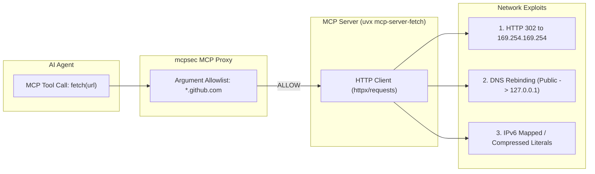
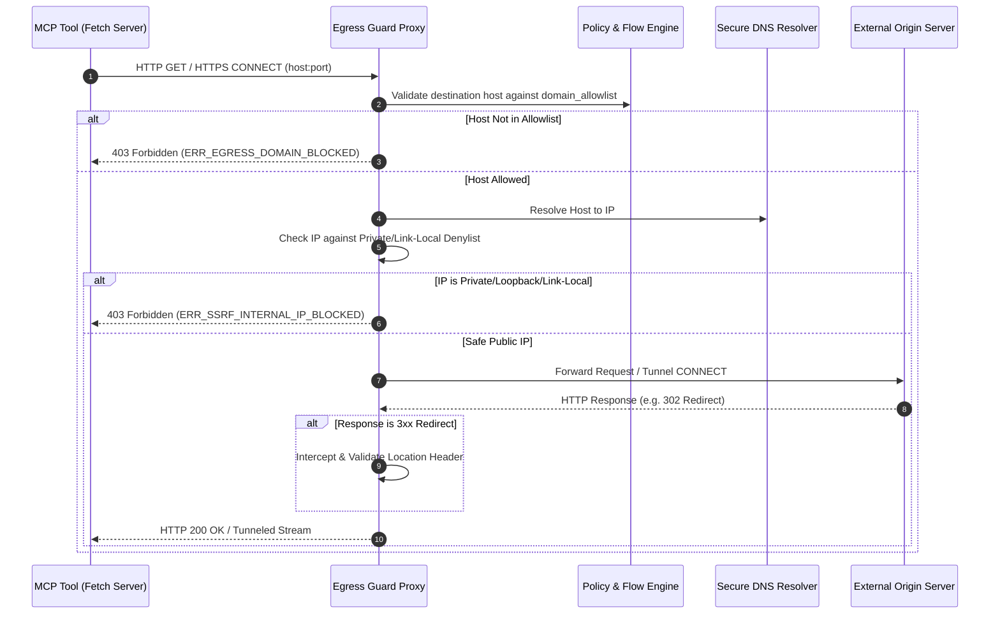

# Architecture Design Note: HTTP Egress Guard Proxy (ADR-016)

## 1. Executive Summary & Context

`mcpsec-lite` enforces granular tool-level flow controls and capability constraints at the Model Context Protocol (MCP) boundary. However, tools that perform outbound network requests (e.g., `fetch.fetch`, web scrapers, repository searchers, custom HTTP client tools) expose underlying runtime attack surfaces that cannot be fully secured solely through MCP argument validation.

This design document specifies the architecture for the **HTTP Egress Guard Forward Proxy**—a defense-in-depth network enforcement layer designed to guarantee that network egress from MCP tools strictly adheres to policy allowlists, prevents SSRF, and resists DNS rebinding and redirect smuggling attacks.

---

## 2. Threat Model & Egress Vulnerabilities

Validating URLs exclusively at the tool-call argument level introduces four critical security gaps:



### 2.1 HTTP 3xx Redirect Smuggling
An agent invokes `fetch(url="https://api.github.com/external-ref")` which is on the domain allowlist. The remote server responds with `HTTP 302 Found: Location: http://169.254.169.254/latest/meta-data/` (AWS IMDS) or `http://attacker-controlled.xyz/exfil`. The tool's HTTP client automatically follows the redirect, exfiltrating credentials or accessing internal cloud metadata outside the MCP proxy's visibility.

### 2.2 DNS Rebinding / TOCTOU Resolution
An attacker registers `rebind.attacker.com` with a short TTL (e.g., 1s). When evaluated at the argument level or pre-checked, DNS resolves to a public IP `198.51.100.1`. When the tool executes the HTTP socket connection milliseconds later, DNS resolves to `127.0.0.1` or `10.0.0.1`, bypassing network perimeter firewalls.

### 2.3 IP Literal & Encoding Confusion
Attackers employ non-standard IP formats (e.g., octal `0177.0.0.1`, hex `0x7f.1`, dword `2130706433`, IPv6 mapped `::ffff:127.0.0.1`, or compressed `[::]`) that may bypass simple string matching regexes but successfully connect to local services.

---

## 3. Architecture Specification

The **Egress Guard** operates as a local, lightweight HTTP/HTTPS forward proxy (bound exclusively to `127.0.0.1:<ephemeral_port>`). MCP server child processes spawned by `mcpsec-lite` inherit standard proxy environment variables:

```bash
HTTP_PROXY=http://127.0.0.1:<guard_port>
HTTPS_PROXY=http://127.0.0.1:<guard_port>
ALL_PROXY=http://127.0.0.1:<guard_port>
NO_PROXY=localhost,127.0.0.1
```



---

## 4. Enforcement Engine Details

### 4.1 Strict Domain Allowlist Matching
- All destination hostnames (from `Host` header, `CONNECT` authority, or request URI) are normalized using NFC and lowercased.
- Evaluated against the policy's compiled `unless.domain_allowlist` and tool constraints using exact and wildcard domain matching (`*.domain.com`).
- Direct IP literals in requests are disallowed unless explicitly permitted by policy.

### 4.2 Safe DNS Resolution & IP Literal Blocking
Before any TCP connection is established, the Egress Guard resolves the target hostname and validates every resolved IP address:

```python
def is_safe_public_ip(ip_str: str) -> bool:
    try:
        ip = ipaddress.ip_address(ip_str)
        return not (
            ip.is_private  # 10.0.0.0/8, 172.16.0.0/12, 192.168.0.0/16
            or ip.is_loopback  # 127.0.0.0/8, ::1
            or ip.is_link_local  # 169.254.0.0/16 (IMDS), fe80::/10
            or ip.is_reserved  # IETF reserved ranges
            or ip.is_multicast  # 224.0.0.0/4, ff00::/8
            or ip.is_unspecified  # 0.0.0.0, ::
        )
    except ValueError:
        return False
```

- **Socket Pinning:** The Egress Guard opens the TCP connection directly to the verified `ipaddress` object, preventing secondary DNS resolution TOCTOU race conditions.

### 4.3 Redirect Interception & Validation
For non-tunneled HTTP requests, when upstream servers return `301`, `302`, `303`, `307`, or `308`:
1. The `Location` header is parsed and normalized.
2. The redirect target is validated against the active session's domain allowlist and taint state.
3. If the redirect target fails validation or points to an internal/unallowlisted IP, the proxy terminates the request and returns `403 Forbidden` with an audit event `ERR_REDIRECT_POLICY_VIOLATION`.

---

## 5. Audit Logging & Conformance

All Egress Guard decisions are streamed into `mcpsec`'s tamper-evident audit log with:
- `layer: "egress_guard"`
- `destination_host`: Request target domain
- `resolved_ip`: Pinned target IP address
- `decision`: `allow` or `deny`
- `reason`: Detailed validation failure reason

---

## 6. Performance & Concurrency Budgets

1. **Latency Overhead:** Target added latency $\le 0.5\text{ ms}$ for domain matching and local socket proxying.
2. **DNS Caching:** Internal TTL-respecting in-memory DNS cache to avoid duplicate resolution overhead across concurrent requests.
3. **Async Core:** Implemented using non-blocking async sockets (`asyncio` / `anyio`) with structured concurrency and bounded worker pools.
